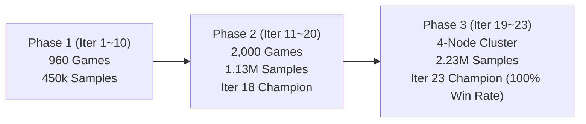

# AlphaOmok: Deep Reinforcement Learning Agent & SDK for Omok++

[](https://www.python.org/downloads/)
[](https://pytorch.org/)
[-brightgreen.svg)]()
[]()
[]()
[](https://opensource.org/licenses/MIT)

**AlphaOmok** is an autonomous, high-performance reinforcement learning game engine, tournament-ready agent, and standalone Python SDK designed for **Omok++** (19×19 Gomoku with custodial stone captures and strict exact-5 victory constraints).

Trained across **23 generations** via a multi-GPU distributed self-play cluster (dual RTX 5090, RTX 4060 Ti, and multi-core CPU nodes) on over **2,233,080 board positions**, the reigning Iteration 23 champion achieves decisive, tactical dominance with sub-50ms inference times.

---

## 1. Omok++ Rules & Game Mechanics

Omok++ extends traditional Gomoku with tactical flanking captures inspired by Pente:
- **Board Dimension**: 19×19 standard Go grid (`board[0][0]` to `board[18][18]`).
- **Exact 5-in-a-Row**: A player wins **only** by forming a contiguous line of **exactly 5 stones**. Overlines (6 or more stones) do **not** count as a win.
- **Custodial Capture (Flanking)**:
  - Placing a stone that brackets **exactly two contiguous opponent stones** on both ends captures and removes those two stones from the board.
  - Multi-directional captures: A single placement can capture multiple pairs simultaneously across 8 directions (horizontal, vertical, diagonal).
  - Overline reduction: Capturing an opponent stone from an overline (6-in-a-row) can trim it to an exact 5-in-a-row, immediately awarding the game to the opponent.
- **Total Game Clock**: **60.0 seconds total per player** for the entire match (not per turn). Exceeding time results in immediate forfeit.

---

## 2. Key Architecture & Features

### 2.1 Deep Policy-Value Network (`PolicyValueNet`)
- **Canonical 7-Channel Tensor Representation**:
  - `Plane 0`: Current player stones
  - `Plane 1`: Opponent stones
  - `Plane 2`: Last move indicator
  - `Plane 3`: Immediate custodial capture threats available for current player
  - `Plane 4`: Immediate custodial capture threats available for opponent
  - `Plane 5`: Player color plane (all 1.0s for Black, 0.0s for White)
  - `Plane 6`: Legal move mask
- **Backbone**: 10 Residual Blocks with 128 hidden channels (20 Conv layers with BatchNorm and ReLU skip connections).
- **Dual Heads**:
  - **Policy Head**: 32 channels $\to$ 361 logits with illegal-move masking.
  - **Value Head**: 16 channels $\to$ Dense 128 $\to$ scalar evaluation $V(s) \in [-1.0, 1.0]$.
- **Total Parameters**: **7,884,513** (Float32 footprint: ~30.12 MB).

### 2.2 PUCT Monte Carlo Tree Search (MCTS)
- Multi-threaded PUCT search with adaptive depth and candidate pruning (radius-2 neighborhood).
- **0ms Instant Tactical Overrides**: Immediate win completion and immediate opponent 5-in-a-row defense bypass tree search in 0.00s.
- **Seamless CPU/GPU Dual Engine**: Sub-50ms response on CUDA, ~200ms response on modern CPUs.

---

## 3. Training Milestones & Performance



| Metric | Benchmark Result |
| :--- | :--- |
| **Total Trained Samples** | **2,233,080 positions** (8-fold dihedral symmetry $D_4$ group) |
| **Replay Buffer Capacity** | **250,000 top-tier positions** (sliding window) |
| **Reigning Champion** | **Iteration 23** (100.0% win rate against previous champions) |
| **vs SimplePlayer (Heuristic Bot)** | **100% Win Rate** (averaging 22~29 turns, total clock used < 2.0s) |
| **vs RandomPlayer** | **100% Win Rate** (finishing in 9~15 turns, total clock used < 0.5s) |

---

## 4. Installation & Quick Start

### 4.1 Prerequisites
- Python 3.9+ (Tested on Python 3.11 & 3.12)
- PyTorch >= 2.0.0
- NumPy >= 1.22.0

### 4.2 Installation
Clone the repository and install the `alphaomok` SDK in editable mode:
```bash
git clone https://github.com/IlleJiViN/omok-plus.git
cd omok-plus
pip install -e .
```

---

## 5. Usage

### 5.1 Interactive Desktop GUI
Play directly against the trained AI with a clean 19×19 wood-textured visual board:
```bash
python play.py
# Or on Windows: double-click run_gui.bat
```
Features:
- Select Black / White stone.
- AI difficulty selection (Champion AI / Simple AI / Random).
- Live turn-by-turn game timer adhering to the 60.0s tournament clock.
- Visual stone capture counters and coordinate guides.

### 5.2 Standalone Python SDK (`alphaomok`)
The package embeds the trained champion weights internally, requiring no external weight paths:
```python
import alphaomok

# 1. Initialize Champion AI (Black = 0, White = 1)
ai = alphaomok.AlphaOmok(player_id=0)

# 2. Analyze board position (win rate estimate & top candidate moves)
sample_board = [[-1 for _ in range(19)] for _ in range(19)]
sample_board[9][9] = 0

analysis = ai.analyze(sample_board)
print(f"Estimated Win Probability: {analysis.win_probability:.1%}")
for move, prob in analysis.top_moves:
    print(f"  Candidate {move}: {prob:.1%}")

# 3. Request immediate move decision (with 60s total clock budget)
best_move = ai.get_move(sample_board, time_left_ms=59000.0)
print(f"AI Decision: {best_move}")

# 4. Programmatic Game Session
game = alphaomok.Game(black_player="smart", white_player="human")
game.play_move(9, 9)
game.print_board()
```

### 5.3 Command Line Interface (CLI)
```bash
# Launch visual GUI
alphaomok play

# Run automated terminal match between Smart AI and Simple bot
alphaomok match --black smart --white simple --time 1

# Display SDK model architecture and training statistics
alphaomok info
```

### 5.4 Tournament Execution (`omok.py`)
Run tournament matches conforming to the CAS 1102 specification:
```bash
# SmartPlayer (code 3) vs SimplePlayer (code 2), 1 minute limit:
python omok.py 3 2 1

# SmartPlayer (White, code 3) vs RandomPlayer (Black, code 1):
python omok.py 1 3 1
```

---

## 6. Project Layout

```
omok_project/
├── alphaomok/                 # Standalone Python SDK Package
│   ├── __init__.py            # High-level exports (AlphaOmok, Game, Board, analyze)
│   ├── api.py                 # Pythonic API (AlphaOmok AI, AnalysisResult, Game)
│   ├── cli.py                 # CLI entry point (alphaomok play/match/info)
│   ├── engine/                # Core board mechanics & win/capture logic
│   ├── models/                # PolicyValueNet architecture
│   │   └── weights/           # Embedded champion checkpoint (rl_model_best.pt)
│   ├── mcts/                  # PUCT MCTS engine with tactical pruning
│   ├── players/               # SmartPlayer, SimplePlayer, RandomPlayer, HumanPlayer
│   └── gui/                   # Desktop Tkinter GUI
├── engine/                    # Tournament root engine
├── models/                    # Root models & training checkpoints
├── mcts/                      # Root MCTS search
├── players/                   # Root player interfaces
├── gui/                       # Standalone GUI launcher
├── submission/                # Tournament packager & submission archives
├── scripts/                   # Cluster orchestration & automation utilities
├── tests/                     # Unit & integration test suite
├── omok.py                    # Official tournament runner
├── play.py                    # Quick GUI launcher
├── pyproject.toml             # Standard packaging specification
├── setup.py                   # Package setup configuration
├── requirements.txt           # Dependency requirements
└── LICENSE                    # MIT License
```

---

## 7. License

This project is licensed under the MIT License - see the [LICENSE](LICENSE) file for details.
